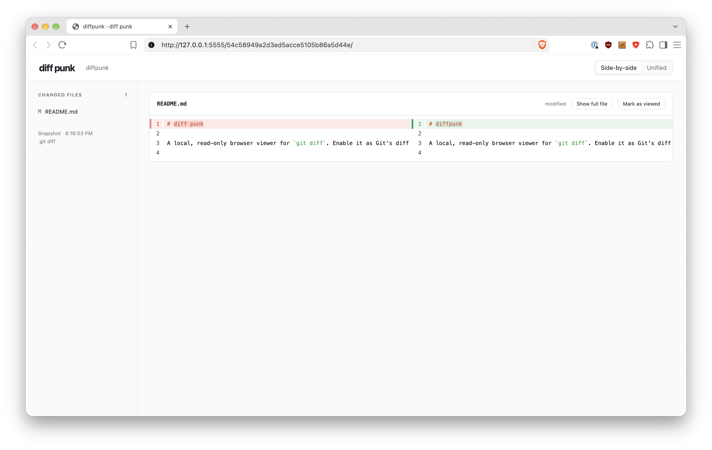
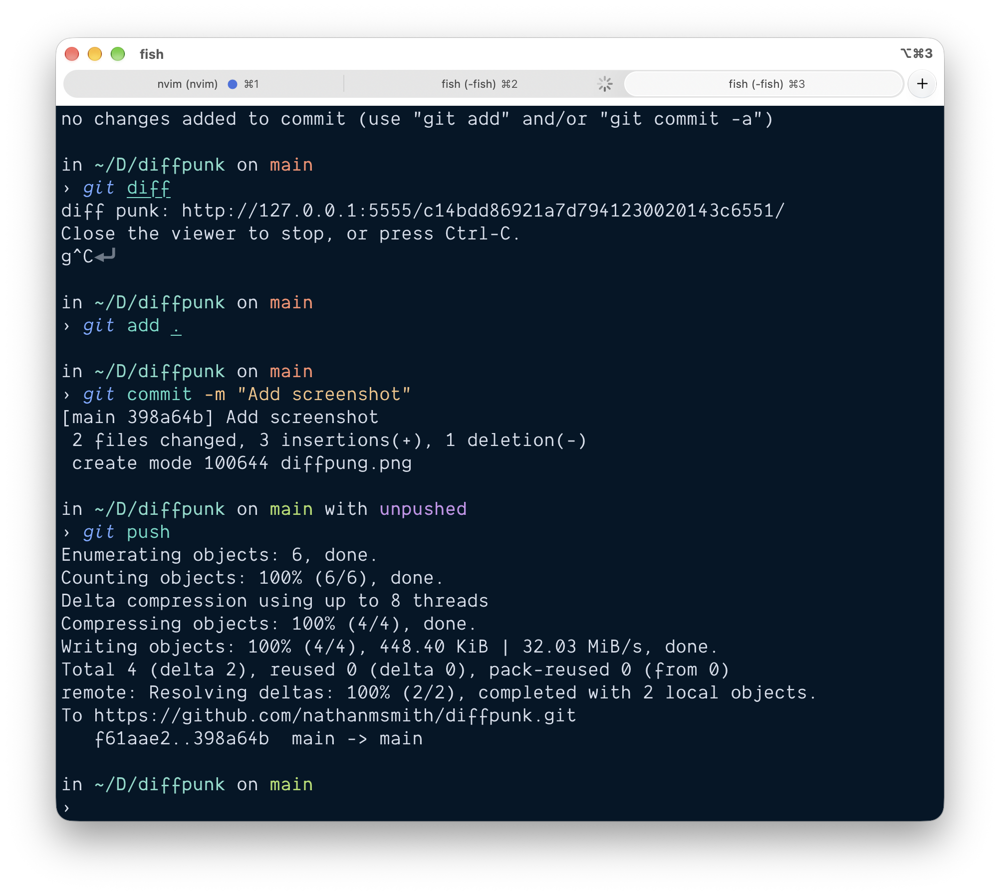

# diffpunk

<table>
  <tr>
    <td></td>
    <td></td>
  </tr>
</table>

A local, read-only browser diff viewer. Drop in replacement for `git diff`.

## Installation

````
brew tap nathanmsmith/diffpunk https://github.com/nathanmsmith/diffpunk.git
brew install --HEAD diffpunk
```

Enable it as Git's diff pager:

```
git config --global pager.diff 'diff-punk --pager'
git diff
git diff --staged
git diff main...HEAD -- src/
```

## How it works

Git sends its output to diff punk, which opens the browser and keeps the terminal
occupied until you close the viewer or press **Ctrl-C**. This setup affects `git diff` only; other Git commands
keep their existing pager. Git retains control of comparison options and exit
status. `git --no-pager diff` bypasses the viewer, and redirected or piped Git
output keeps its normal behavior. To disable the integration:

```sh
git config --global --unset pager.diff
```

You can also run the standalone executable with the same arguments you would
pass to Git:

```sh
dp                    # unstaged changes
dp --staged           # staged changes
dp HEAD               # working tree compared with HEAD
dp main...HEAD        # branch changes since the merge base
dp -U10 -- src/       # more context, limited to a path
```

The command opens your default browser and keeps a local server running on
`127.0.0.1:5555`. If port 5555 is already in use, startup fails. Press
**Ctrl-C** in the terminal to stop it, or close all viewer tabs.
